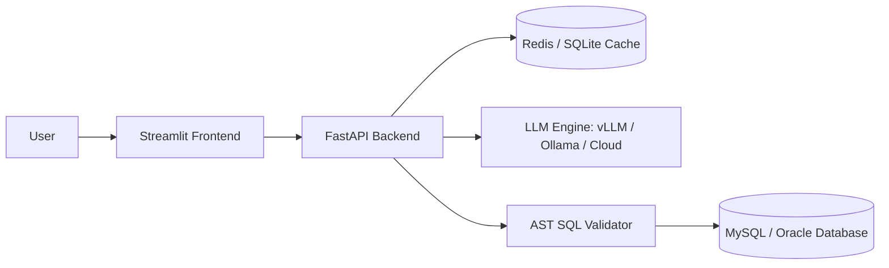

# MyDB Chatbot

[](https://www.python.org/downloads/)
[](https://fastapi.tiangolo.com/)
[](https://streamlit.io/)
[](https://www.docker.com/)
[](LICENSE)

An enterprise natural language interface for relational databases (MySQL, Oracle, and SQLite). The system translates conversational prompts in English and Indonesian into validated SQL queries, executes them with strict read-only safety guards, and returns structured data alongside interactive visualizations.

## Key Features

- **Natural Language to SQL**: Converts complex conversational questions into optimized SQL queries with schema introspection.
- **Intelligent Visualization**: Automatically detects result distributions and renders Plotly charts (bar, line, pie, scatter).
- **Multi-Tier Caching**: Built-in SQLite and Redis caching layers for query deduplication, latency reduction, and API cost control.
- **Query Safety & Validation**: AST-level SQL validation blocking DDL/DML statements (`DROP`, `DELETE`, `UPDATE`, `INSERT`, `ALTER`) to guarantee read-only execution.
- **Multi-LLM Provider Support**: Pluggable backend supporting local inference (vLLM, Ollama, quantized Mistral 7B GGUF) and cloud models (Gemini 2.0, OpenAI GPT-4).
- **Asynchronous Processing**: Background task queue for heavy summarization workloads with polling status endpoints.
- **Interactive UI**: Streamlit dashboard with session management, history export, and live query exploration.

## Architecture



- **Frontend**: Streamlit interactive client.
- **Backend**: FastAPI async REST server with JWT authentication and rate limiting.
- **Execution & Validation**: AST validator and dialect-aware schema injector.
- **LLM Layer**: Local models via vLLM/Ollama or cloud fallback via OpenAI/Gemini SDKs.

## Technology Stack

- **Backend**: Python 3.11, FastAPI, Pydantic v2, Uvicorn
- **Frontend**: Streamlit, Plotly
- **Database**: MySQL, Oracle DB, Redis, SQLite
- **LLM Runtimes**: vLLM (LoRA support), Ollama, Google GenAI SDK, OpenAI SDK
- **Testing & Quality**: Pytest, Pytest-Asyncio, Ruff, Black

## Quick Start

### Prerequisites
- Python 3.11+
- MySQL Database (5.7 or 8.0+)
- Local Ollama runtime or an LLM API key (Google AI Studio / OpenAI)

### Installation

1. Clone the repository:
   ```bash
   git clone https://github.com/jamrud007/mydb-chatbot.git
   cd mydb-chatbot
   ```

2. Install dependencies:
   ```bash
   pip install -r requirements.txt
   ```

3. Configure environment variables:
   ```bash
   cp .env.example .env
   ```
   Update `.env` with your database credentials and preferred AI provider.

### Running the Services

Start the backend API (FastAPI):
```bash
python main.py
```

In a separate terminal, start the frontend dashboard (Streamlit):
```bash
streamlit run streamlit_app.py
```

Access the web interface at `http://localhost:8501` and interactive API docs at `http://localhost:8000/docs`.

## Docker Deployment

To launch the complete multi-service stack (Backend, Frontend, Redis, MySQL):

```bash
docker-compose up -d
```

For GPU-accelerated vLLM deployment, refer to [docker/README_VLLM.md](docker/README_VLLM.md).

## Configuration & Local LLM

### Database Connection
The application introspects table schemas dynamically. Set your connection details in `.env`:
```env
DB_HOST=localhost
DB_PORT=3306
DB_USER=root
DB_PASSWORD=your_password
DB_NAME=your_database
```

### Local Inference via Ollama
To run completely offline without external API dependencies:
1. Install [Ollama](https://ollama.ai/).
2. Pull or create your local model:
   ```bash
   ollama run mistral
   ```
3. Set `AI_PROVIDER=ollama` and `OLLAMA_MODEL=mistral` in `.env`.

### CPU Optimization
For low-resource or CPU-only servers:
- Set `ENABLE_DATA_ANALYSIS=False` to return SQL query results instantly (0.5s) without waiting for narrative text generation.
- Use 4-bit quantized GGUF models (`Q4_K_M`) for local inference.

## Testing

Run the automated test suite with pytest:

```bash
# Run all tests
pytest

# Run specific modules
pytest tests/test_api_endpoints.py
pytest tests/test_sql_validator.py
pytest tests/test_metrics.py
```

## Security

- **AST Validation**: Queries are parsed into abstract syntax trees to enforce SELECT-only constraints.
- **Authentication**: JWT token verification on all protected endpoints.
- **Input Sanitization**: Parameterized queries and strict character filtration.
- **Least Privilege**: Designed to operate with read-only database user grants.

## License

This project is licensed under the MIT License - see the [LICENSE](LICENSE) file for details.
