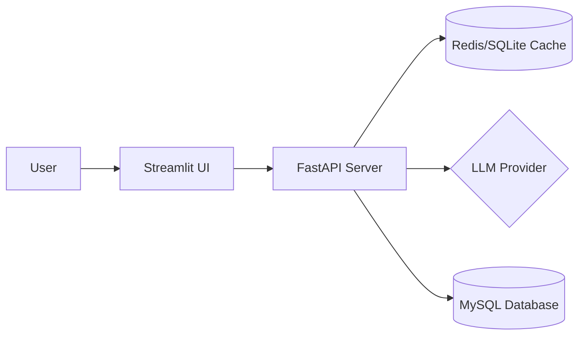

# MyDB Chatbot 🤖

[](https://www.python.org/downloads/)
[](https://fastapi.tiangolo.com/)
[](https://streamlit.io/)
[](https://www.docker.com/)
[](LICENSE)

**MyDB Chatbot** is a powerful natural language interface for your databases (MySQL, Oracle, and more). It leverages advanced LLMs (Gemini, OpenAI, Ollama) to translate plain English/Indonesian questions into optimized SQL queries, visualize the results, and provide intelligent data analysis—all in real-time.

## ✨ Key Features

- **🗣️ Natural Language to SQL**: Ask complex questions in plain language (multilingual support).
- **📊 Intelligent Visualization**: Automatically selects and renders the best charts (Bar, Line, Pie, Scatter) for your data.
- **⚡ Smart Caching**: Built-in SQLite/Redis caching for instant responses and API cost optimization.
- **🛡️ Enterprise-Grade Security**: Read-only safeguards, SQL injection prevention, and strict query validation.
- **🔌 Multi-LLM Support**: Seamlessly switch between Gemini 2.0 Flash, OpenAI GPT-4, DeepSeek, or local Ollama models.
- **📝 Interactive Dashboard**: Built with Streamlit for a responsive, user-friendly data exploration experience.

## 🚀 Quick Start

### Prerequisites
- Python 3.11+
- MySQL Database (5.7 or 8.0+)
- An LLM API Key (Google AI Studio or OpenAI) or a local Ollama instance.

### Installation

1. **Clone the repository**
   ```bash
   git clone https://github.com/yourusername/mysql-chatbot.git
   cd mysql-chatbot
   ```

2. **Install dependencies**
   ```bash
   pip install -r requirements.txt
   ```

3. **Configure Environment**
   ```bash
   cp .env.example .env
   ```
   Edit `.env` and populate your database credentials and API keys:
   ```env
   DB_HOST=localhost
   DB_USER=root
   DB_PASSWORD=yourpassword
   DB_NAME=your_database
   GEMINI_API_KEY=your_api_key
   ```

### Running the Application

**Backend (FastAPI)**
```bash
python main.py
```

**Frontend (Streamlit)**
```bash
streamlit run streamlit_app.py
```

Visit `http://localhost:8501` to start chatting with your data!

## ⚙️ Advanced Configuration (CPU & Universal DB)

### 1. Universal Database Support 🌍
This chatbot is **Database Agnostic**. It automatically reads your table schema dynamically. To switch databases:
1. Update `.env`:
   ```env
   DB_HOST=localhost
   DB_USER=root
   DB_PASSWORD=new_password
   DB_NAME=your_new_database
   ```
2. Restart the backend: `python main.py`
3. The "Diet Schema" prompt will auto-adapt to your new tables.

### 2. CPU Optimization Flags ⚡
For deployment on non-GPU environments (standard laptops/servers), use these settings in `.env` to prevent timeouts:

- **`ENABLE_DATA_ANALYSIS=False`**: Disables the heavy "Data Analyst" summarization step. Chatbot returns SQL results instantly (0.5s) instead of waiting for narrative generation (10m+ on CPU).
- **`OLLAMA_MODEL=mysql-nl2sql`**: Use our custom quantized GGUF model (Q4_K_M) with a 2048 context window for maximum speed.

### 3. Local LLM (Ollama) Setup 🦙
1. Install [Ollama](https://ollama.ai/).
2. Create the custom efficient model:
   ```bash
   ollama create mysql-nl2sql -f Modelfile
   ```
3. Run the model:
   ```bash
   ollama serve
   ```
4. Set `.env` to `AI_PROVIDER=ollama`.

## 🐳 Docker Support

Deploy instantly with Docker Compose:

```bash
docker-compose up -d
```
The application will be available at `http://localhost:8501`.

## 🏗️ Architecture



- **Frontend**: Streamlit for rapid interactive UI development.
- **Backend**: FastAPI for high-performance, async API handling.
- **Intelligence**: LangChain/LLM integration for SQL synthesis and result analysis.
- **Data Layer**: Direct MySQL integration with SQLAlchemy/Connector.

## 🛠️ Technology Stack

- **Core**: Python 3.11
- **Web**: FastAPI, Streamlit
- **Database**: MySQL, Redis, SQLite
- **AI/ML**: Google Gemini, OpenAI, Ollama
- **Visualization**: Plotly Interactive Charts

## 🔒 Security Features

- **JWT Authentication**: Secure API access with bearer tokens.
- **Input Sanitization**: Strict validation for SQL injection prevention.
- **Least Privilege**: Database connection uses restricted permissions where possible.
- **Encrypted Secrets**: Environment variables for sensitive keys.

## 🧪 Testing

Run the automated test suite to verify system integrity:

```bash
# Run all tests
pytest

# Run specific test modules
pytest tests/test_utils.py
pytest tests/test_mock_llm.py
```

## 🤝 Contributing

Contributions are welcome! Please feel free to submit a Pull Request.

1. Fork the project
2. Create your feature branch (`git checkout -b feature/AmazingFeature`)
3. Commit your changes (`git commit -m 'Add some AmazingFeature'`)
4. Push to the branch (`git push origin feature/AmazingFeature`)
5. Open a Pull Request

## 📝 License

This project is licensed under the MIT License - see the [LICENSE](LICENSE) file for details.
