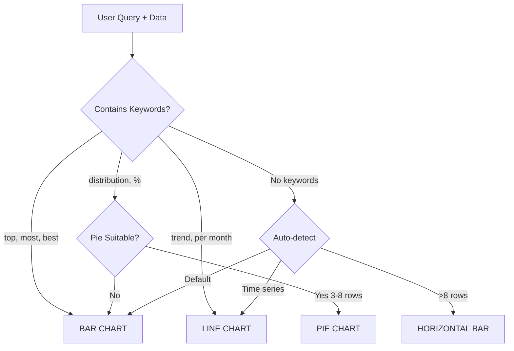

# 🎯 Smart Chart Selection - Implementation Summary

## What Was Improved

Added **intelligent keyword detection** to automatically choose the right chart type based on user intent, not just data structure.

---

## The Problem

**Before**: Query **"Top 10 cities by customer count"** showed **PIE CHART** ❌

**Why it was wrong**:
- User asked for "TOP" (comparison)
- But got pie chart (for distribution/proportions)
- All values were 1 (perfectly equal) → misleading pie chart

---

## The Solution

### 1. Keyword Detection System

Added 3 categories of keywords:

#### 🔵 **Comparison Keywords** → BAR CHART
```python
['top', 'highest', 'most', 'best', 'worst', 'largest', 'terbanyak', 'tertinggi']
```
**Examples:**
- "Top 10 cities" → Bar Chart
- "Highest sales" → Bar Chart  
- "Most popular products" → Bar Chart

#### 📈 **Trend Keywords** → LINE CHART
```python
['trend', 'over time', 'per month', 'per year', 'per day', 'monthly', 'daily', 'yearly']
```
**Examples:**
- "Orders per month" → Line Chart
- "Sales trend over time" → Line Chart
- "Daily revenue" → Line Chart

#### 🥧 **Distribution Keywords** → PIE CHART
```python
['distribution', 'percentage', 'proportion', 'breakdown', 'share', 'distribusi', 'persentase']
```
**Examples:**
- "Distribution of order status" → Pie Chart
- "Percentage by payment type" → Pie Chart
- "Market share breakdown" → Pie Chart

---

### 2. Stricter Pie Chart Conditions

**Old**:
- 1 numeric column
- ≤ 10 rows
- All positive values

**New** (improved):
- 1 numeric column
- **3-8 rows** (not 2, not 10)
- All positive values
- **Values must be diverse** (not all same)
- No single value > 80% of total

**Why**: Pie charts are for showing **proportions**, not comparisons.

---

### 3. Context-Aware Selection

Now passes **original user query** to visualization helper:

```python
# chatbot_handler.py
viz_config = VisualizationHelper.analyze_for_visualization(
    exec_result['rows'],
    exec_result['columns'],
    user_query=original_query  # ← NEW!
)
```

---

## Decision Flow



---

## Examples: Before vs After

### Query 1: "Top 10 cities by customer count"
- **Before**: 🥧 Pie Chart (WRONG)
- **After**: 📊 Bar Chart (CORRECT) ✅
- **Reason**: Keyword "top" detected → comparison intent

### Query 2: "Show orders per month"
- **Before**: 📊 Bar Chart
- **After**: 📈 Line Chart ✅
- **Reason**: Keyword "per month" → time series

### Query 3: "Distribution of payment types"
- **Before**: 📊 Bar Chart
- **After**: 🥧 Pie Chart ✅
- **Reason**: Keyword "distribution" → proportion intent

### Query 4: "Percentage of order status"
- **Before**: 📊 Bar Chart
- **After**: 🥧 Pie Chart ✅
- **Reason**: Keyword "percentage" → proportion

---

## Files Modified

### 1. `utils/visualization_helper.py`
**Changes:**
- Added `user_query` parameter to `analyze_for_visualization()`
- Added keyword detection in `_determine_chart_type()`
- Stricter pie chart conditions (3-8 rows, diverse values)
- Support for English & Indonesian keywords

**New Logic:**
```python
# Check for comparison keywords
if 'top' in query or 'most' in query:
    return BAR_CHART

# Check for time keywords  
if 'per month' in query or 'trend' in query:
    return LINE_CHART

# Check for distribution keywords
if 'distribution' in query or 'percentage' in query:
    return PIE_CHART (if suitable)
```

### 2. `chatbot/chatbot_handler.py`
**Changes:**
- Get original user question from conversation context
- Pass `user_query` to visualization helper

---

## Testing Guide

Try these queries to see different chart types:

### 📊 Bar Charts:
```
Top 10 cities by customer count
Show me the highest selling products
Which sellers have the most orders?
```

### 📈 Line Charts:
```
Show orders per month in 2017
What is the sales trend over time?
Daily revenue for last 30 days
```

### 🥧 Pie Charts:
```
Distribution of order status
Percentage of each payment type
Breakdown of product categories (limit 5)
```

---

## Benefits

1. ✅ **Smarter**: Understands user intent from question
2. ✅ **Multilingual**: Works with English & Indonesian
3. ✅ **Flexible**: Keyword detection + auto-detection fallback
4. ✅ **Accurate**: Right chart for right purpose
5. ✅ **User-friendly**: No manual chart type selection needed

---

## Next Steps

### Optional Enhancements:

1. **User Override**: Add buttons to manually switch chart types
2. **More Keywords**: Add more industry-specific keywords
3. **Chart Type Hints**: Show why a chart type was chosen
4. **Multi-language**: Add more language support

---

**Status**: ✅ **Implemented & Ready**

**Action Required**: 
1. Refresh browser (Ctrl+F5)
2. Test with queries from `TEST_QUERIES.md`
3. Verify "Top 10 cities" now shows BAR chart, not PIE!

🚀 **Chart selection is now INTELLIGENT!**
