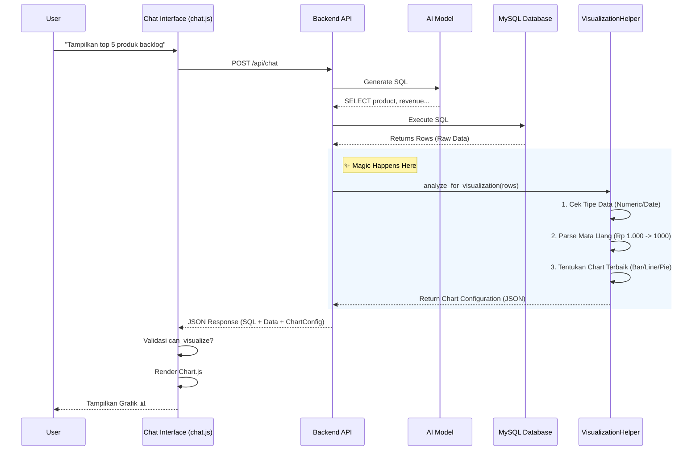

# 📊 Proses Visualisasi Data

Dokumen ini menjelaskan bagaimana chatbot menerjemahkan pertanyaan bahasa alami menjadi grafik visual yang interaktif.

## 🔄 Alur Kerja (Workflow)



## 🛠️ Komponen Utama

### 1. `VisualizationHelper.py` (Otak Visualisasi)
Modul ini bertugas menganalisis data mentah dari database.
*   **Deteksi Tipe Data**: Membedakan mana kolom kategori (untuk sumbu X) dan mana kolom angka (untuk sumbu Y).
*   **Smart Parsing**: Menggunakan fungsi `_parse_value` untuk membersihkan format uang (seperti `Rp 1.250.000,00` atau `1,250.00`) menjadi angka murni `1250000.0`.
*   **Pemilihan Chart Otomatis**:
    *   **Bar Chart**: Untuk perbandingan (contoh: "Top 5 Sales").
    *   **Line Chart**: Jika ada kolom waktu/tanggal (contoh: "Tren penjualan 2023").
    *   **Pie Chart**: Untuk distribusi proporsional (contoh: "Persentase status order") dengan syarat jumlah data sedikit (3-8 kategori).

### 2. `chat.js` & Chart.js (Pelukis Grafik)
Di sisi frontend (browser), kami menggunakan library **Chart.js**.
*   Menerima konfigurasi JSON dari backend.
*   Menggambar grafik di element `<canvas>`.
*   Menambahkan interaksi (hover tooltip) dan styling (gradasi warna, animasi).

### 3. Analytics API (`api/analytics.py`)
Selain chat, kita juga punya endpoint khusus untuk dashboard analitik yang memintas AI dan langsung menyajikan grafik statistik standar.

## 📝 Contoh Data JSON
Backend mengirim data seperti ini ke Frontend:

```json
{
  "can_visualize": true,
  "chart_type": "bar",
  "chart_data": {
    "labels": ["Electronics", "Auto", "Beauty"],
    "datasets": [{
      "label": "Total Revenue",
      "data": [50000, 30000, 15000],
      "backgroundColor": "rgba(99, 102, 241, 0.8)"
    }]
  },
  "reason": "Bar chart cocok untuk membandingkan revenue antar kategori."
}
```
